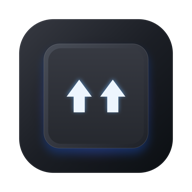
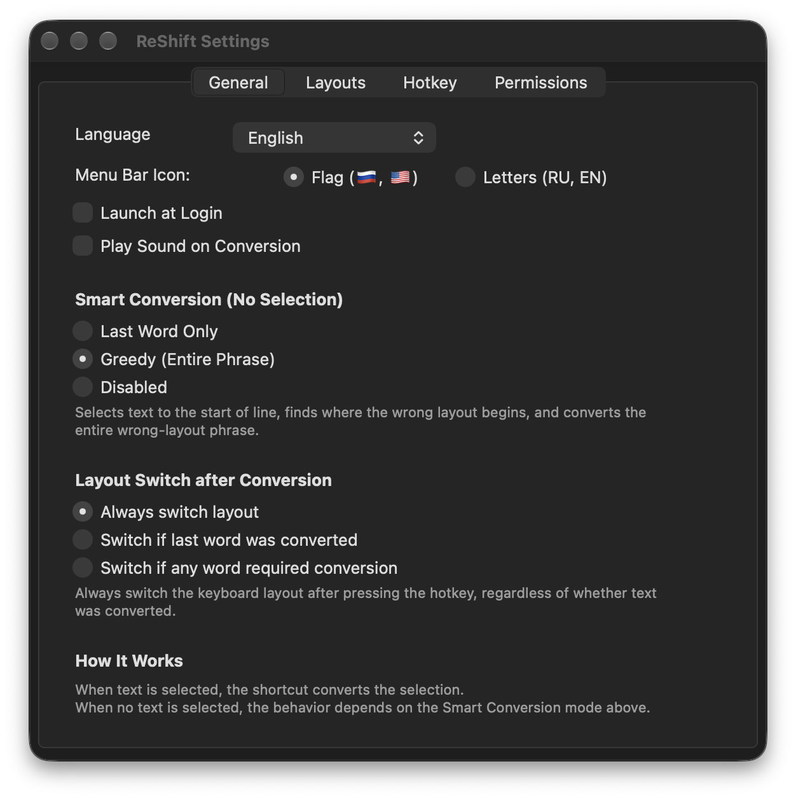

<p align="center">
  
</p>

<h1 align="center">ReShift</h1>

<p align="center">
  <b>⚡️ Blazing fast, native keyboard layout text converter for macOS written in Rust 🦀</b>
</p>

<p align="center">
  <a href="README.ru.md">🇷🇺 Русская версия</a>
</p>

<p align="center">
  
  
  
  
  
  
</p>

<p align="center">
  
</p>

<p align="center">
  <a href="https://github.com/aliaksandrsen/ReShift/releases/latest"><b>📥 Download ReShift for macOS (.dmg / .zip)</b></a>
</p>

Converts text typed in the wrong layout (`ghbdtn` => `привет`) with a double Shift tap or a customizable hotkey.

## Features

- ⚡️ **Blazing Fast**: Background conversion pipeline — zero UI lag or freezing (< 0.2 ms).
- 🌐 **Menu Bar Indicator**: Shows layout flags (`🇷🇺`, `🇺🇸`) or language letters (`RU`, `EN`), updating instantly.
- 🧠 **Smart Conversion**: Converts selected text or wrong-layout line tails without selection (greedy phrase matching or last word).
- 🛡️ **Safe Clipboard**: Preserves all data types (images, files, formatted text) and restores your original clipboard after conversion.
- 🎨 **Native AppKit**: Clean native settings window supporting macOS Dark and Light modes.
- 🪶 **Ultra Lean**: ~1 MB application bundle, ~16 MB idle memory footprint.

## Building

Requirements: Rust (stable) and Xcode Command Line Tools.

```bash
# Run unit tests
cargo test --workspace

# Build and package signed ReShift.app
./scripts/build.sh
```

The signed application bundle is generated in `artifacts/ReShift.app`.

## Acknowledgments & Inspiration

ReShift is inspired by the ideas, heritage, and pioneers of keyboard layout switching:

- [Punto Switcher](https://yandex.ru/soft/punto/) — the pioneering keyboard layout switcher.
- [Caramba Switcher](https://caramba-switcher.com/) — intelligent, silent background layout switching.
- [langSwitcher](https://github.com/reg2005/langSwitcher) — open-source macOS Swift keyboard layout converter by @reg2005.

> ⚠️ **Note**: ReShift is under active development (v0.1.0) — features, UI, and shortcuts are actively evolving. Feedback and suggestions are welcome!

## License

[MIT](LICENSE) — Copyright (c) 2026 ReShift Contributors.
