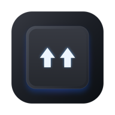
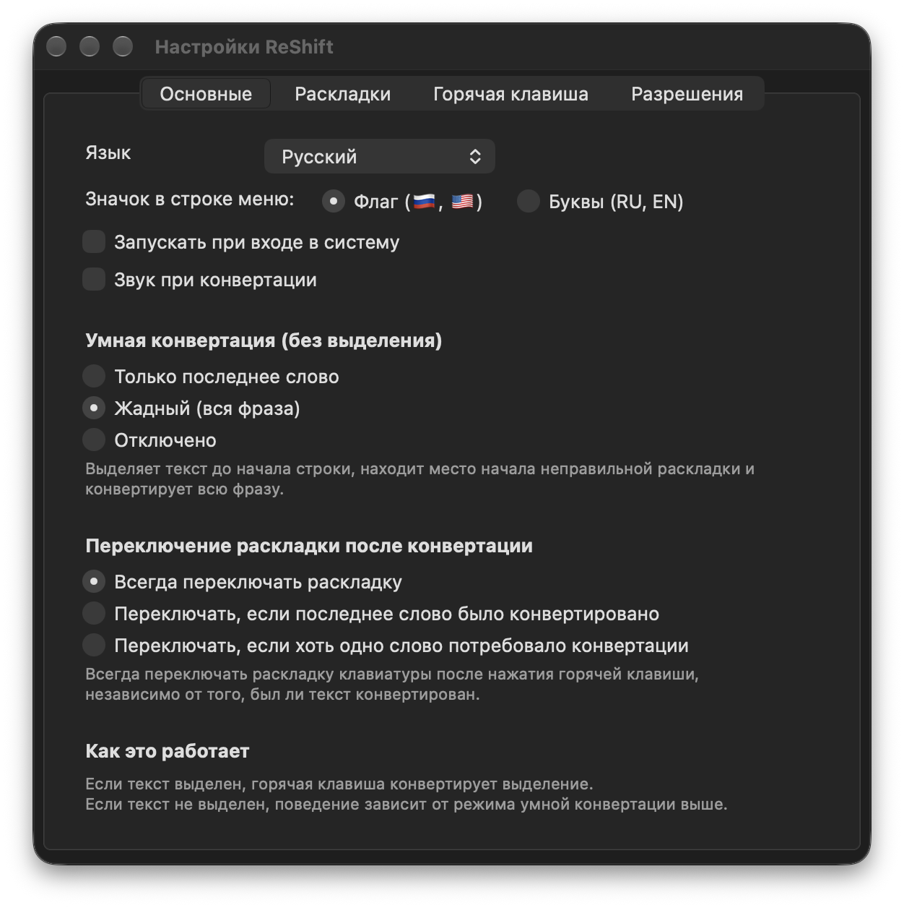

<p align="center">
  
</p>

<h1 align="center">ReShift</h1>

<p align="center">
  <b>⚡️ Мгновенный, легковесный конвертер раскладки клавиатуры для macOS на Rust 🦀</b>
</p>

<p align="center">
  <a href="README.md">🇬🇧 English version</a>
</p>

<p align="center">
  
  
  
  
  
  
</p>

<p align="center">
  
</p>

<p align="center">
  <a href="https://github.com/aliaksandrsen/ReShift/releases/latest"><b>📥 Скачать ReShift для macOS (.dmg / .zip)</b></a>
</p>

Исправляет текст, набранный не в той раскладке (`ghbdtn` => `привет`), по двойному нажатию Shift или настраиваемой горячей клавише.

## Возможности

- ⚡️ **Мгновенная работа**: Фоновый конвейер конвертации без малейших задержек (< 0.2 мс).
- 🌐 **Индикатор в строке меню**: Отображает текущую раскладку с флагами (`🇷🇺`, `🇺🇸`) или буквами языка (`RU`, `EN`), обновляясь моментально.
- 🧠 **Умная конвертация**: Автоматически конвертирует выделенный текст или хвост строки без выделения (жадный поиск фразы или последнее слово).
- 🛡️ **Безопасный буфер обмена**: Сохраняет все типы данных (изображения, файлы, форматирование) и возвращает исходный буфер обмена пользователя.
- 🎨 **Нативный AppKit**: Чистое нативное окно настроек с поддержкой тёмной и светлой тем macOS.
- 🪶 **Компактность**: ~1 МБ размер бандла приложения, ~16 МБ оперативной памяти в простое.

## Сборка

Требования: Rust (stable) и инструменты командной строки Xcode (Command Line Tools).

```bash
# Запуск тестов
cargo test --workspace

# Сборка и упаковка подписанного бандла ReShift.app
./scripts/build.sh
```

Подписанный бандл приложения создаётся в `artifacts/ReShift.app`.

## Вдохновлено проектами

ReShift вдохновлен идеями и разработками в области автоматического переключения раскладки:

- [Punto Switcher](https://yandex.ru/soft/punto/) — легендарный первопроходец автоматического переключения раскладки.
- [Caramba Switcher](https://caramba-switcher.com/) — умное и тихое фоновое переключение раскладки.
- [langSwitcher](https://github.com/reg2005/langSwitcher) — открытый конвертер раскладки для macOS на Swift от @reg2005.

> ⚠️ **Примечание**: ReShift находится в активной разработке (v0.1.0) — функции, интерфейс и настройки могут меняться. Будем рады вашим отзывам и предложениям!

## Лицензия

[MIT](LICENSE) — Copyright (c) 2026 ReShift Contributors.
